  <picture>
    <source media="(prefers-color-scheme: light)" srcset="./assets/profile-banner-light.svg" />
    
  </picture>
   
  
    

# Devlify Team

**We build dependable digital products for real-world needs.**

Devlify Team builds web and mobile applications, business platforms, practical AI/ML features, and developer tools. Our work spans full-stack product development, APIs, databases, automation, and deployment.

  <picture>
    <source media="(prefers-color-scheme: light)" srcset="./assets/divider-light.svg" />
    
  </picture>

## What we build

  <picture>
    <source media="(prefers-color-scheme: light)" srcset="./assets/capabilities-light.svg" />
    
  </picture>

- Web and mobile applications
- Business platforms and SaaS products
- APIs, data systems, and automation
- Applied AI/ML and developer tools

  <picture>
    <source media="(prefers-color-scheme: light)" srcset="./assets/divider-light.svg" />
    
  </picture>

## How we work

- **Build for real use:** connect interfaces, APIs, data, and operational needs.
- **Keep systems understandable:** favor clear structure and maintainable code.
- **Use ML responsibly:** make scope and limitations clear, and ground evaluation in data.
- **Deliver with care:** test important paths and verify changes before release.

  <picture>
    <source media="(prefers-color-scheme: light)" srcset="./assets/divider-light.svg" />
    
  </picture>

## Devlify Marketplace

  

Devlify brings software buyers and developers together. Browse production-ready web, mobile, and AI systems, buy a ready-made build or license its source code, hire a developer, or commission a custom project. Listings show their technology stack and delivery method. Fixed-price purchases are available in naira through Paystack; custom work is scoped and quoted before it begins.

  <a href="https://devlify.com.ng/marketplace">Browse the marketplace</a> &nbsp;·&nbsp;
  <a href="https://devlify.com.ng/hire">Hire a developer</a> &nbsp;·&nbsp;
  <a href="https://devlify.com.ng/services">Custom services</a> &nbsp;·&nbsp;
  <a href="https://devlify.com.ng/about">About Devlify</a> &nbsp;·&nbsp;
  <a href="https://devlify.com.ng/contact">Contact</a> &nbsp;·&nbsp;
  <a href="mailto:contact@devlify.com.ng">Email Devlify</a>

  <picture>
    <source media="(prefers-color-scheme: light)" srcset="./assets/divider-light.svg" />
    
  </picture>

## Explore Devlify

- [Website](https://devlify.com.ng/)
- [GitHub organization](https://github.com/Devlify-Team)
